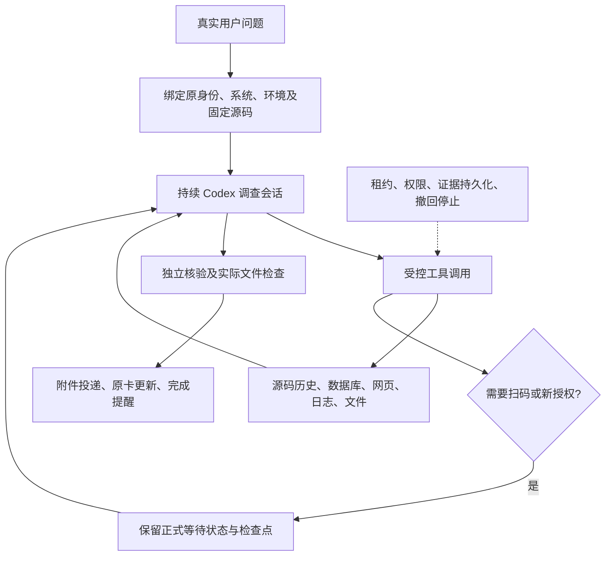

# 持续会话直接调用调查工具

## 用途与流程

旧连续调查已能保留同一个业务任务，但源码执行、环境规划、源码复核仍可能分别启动模型调用。新执行器让源码调查的 Codex 会话直接选择既有授权工具；环境执行器作为协程返回下一份工具目录或取证结果，不再创建另一个环境模型。

接单时已经签发首个环境读取计划的新任务，也直接进入主调查会话：先固定原环境源码，再将原批准计划交给同一个环境执行器协程，把工具目录返回主模型。不会先启动旧环境规划模型、完成一轮后再重开源码模型。计划本身、租约、原身份、数据源指纹和逐工具权限复核不变；尚有旧模型线程或检查点的任务继续原流程，不在运行中迁移。主会话结束来源时仍提交持久取证结果，真实登录等待和双环境固定源码交接保留。

这减少的是阶段交接和重复规划，不承诺删除必要的模型推理、数据库依赖或核验。每次主模型处理工具返回仍可能需要一次模型推理，不能把“一个持续会话”说成“只请求模型一次”。跨源码环境仍先通过既有独立固定源码交接；不把测试、生产或其它系统的证据混成同一版本。

## 配置与兼容

Runner 配置 `analysisEngine` 对应环境变量 `AGENTOS_ANALYSIS_ENGINE`，可取 `legacy` 或 `native-tools-v1`。默认 `legacy`，新引擎先在隔离验证中启用；独立实例在 runtime/instance.local.json 配置 analysisEngine: "native-tools-v1"，启动器校验并在清除继承环境变量后传给本实例 Runner；默认 legacy。正式启用必须在空闲维护窗口更新实例配置并重启，health.analysisEngineForNewTasks 和 Runner 心跳可核对实际选择。不能仅设置变量就声称已完成真实卡片验收。

`native-tools-v1` 只适用于连续只读调查的 developer 阶段。已有 CLI 会话继续使用原引擎；已持久化新引擎检查点的任务保持新引擎，不能在恢复时静默换成 CLI。回退新代码前必须先完成或明确处理这些新检查点，不可把它们交给不支持动态工具的旧版本。

入口：`codex-executor.js` 选择执行器；`native-investigation.js` 管理本机 stdio App Server 与原问题检查点；`investigation-direct-tools.js` 通过原控制平面申请范围，复用 `executeEnvironmentJob`；`investigation-tool-channel.js` 用外层会话的工具选择替代环境模型。写代码、QA、普通聊天流程保持原执行器。

## 权限与恢复

- 只接管 `item/tool/call`，严格绑定当前 thread/turn 和已登记工具。内置命令、文件和权限审批请求仍拒绝，普通聊天连接默认没有工具处理器。
- 数据库、网页、日志仍逐步执行原范围核验、过期续期、跨系统目录检查与完整数据/报表核验。不创建新的数据库权限，不把群成员提升为管理员。
- 环境工具保留原连接、结果存储、草稿与独立文件检查；真实等待、失败及未知结果不会变成已成功取证。
- 每个动态调用以任务/提问者/工作区/thread/callId 和参数摘要绑定，结果持久化后才回给模型。重复相同调用复用回执，改变参数拒绝；执行后未能持久化的未知结果不盲目重放。
- 回执位于任务 exports/tool-results，处于模型可写 working 之外。大结果保留完整引用及分页读取，避免重复向上下文灌入全量数据。
- 关闭、进程退出和用户撤回仍走现有任务进程树。任务进行中不切换引擎、不重启消费者。

## 验证与观测

定向测试覆盖旧线程兼容、并发重复调用、跨线程拒绝、未知调用恢复、两来源协程、撤权、登录等待与源码环境切换。真实模型隔离试验使用合成数据，记录 `nativeTiming.modelSessions`、`environmentModelSessions`、工具调用数和墙钟时间；这些不是完整业务卡片的速度验收。

生产切换前还需同题真人新卡对照：保持模型、数据范围和验收要求一致，分别记录排队、源码准备、模型与工具、核验和投递耗时；无论成败均撤回维护测试消息。不得以减少交接次数推算整题提速比例。未验证其它操作系统及完整跨机迁移；打包需包含新模块，私有迁移保留原任务检查点、源码、数据集与工具回执。

### Legacy-shaped continuation compatibility

If the native model still returns environmentQuery, websiteQuery or sourceHistoryQuery, the host consumes the request through the same validated direct tools and supplies the observation to another turn on the same App Server thread. It does not hand that request back to the nested environment-model pipeline. Host-generated continuation operations use durable call receipts as well. Genuine login/approval waiting and independent source-environment transitions still leave the turn with their original state. nativeTiming distinguishes modelTurns and hostContinuations from modelSessions.

An unknown tool name is not a database permission refusal. The investigator executes nothing and returns its actual catalog for correction. An identical unexecuted choice repeated after this feedback is reported as TOOL_SELECTION_REPEAT, preserving evidence. This is semantic no-progress detection, not a task duration or total-call cap. Actual grant revocation and scope errors still stop the attempted read.

Native environment opens carry the host-owned, still-open `original-question` goal into the existing continuation validator. A request cannot introduce arbitrary goals or bypass scope, approval or source/environment checks. Opening or closing a source does not mark the question verified. CNB PR GET retries respect server Retry-After (seconds or HTTP date), check the current grant while waiting, and distinguish rate limiting from missing permissions. Exhausted temporary retries preserve partial pages; callers should request only failed repositories instead of repeating successful inventories. These retries do not add a whole-task deadline.
A rejected premature close leaves the source open and its corrective observation returns to the same model turn chain. It must not be followed by opening another source. Actual cancellation/shutdown rejects the channel wait; the existing investigator persists evidence and releases its tools rather than synthesizing repeated finish choices.
Native large observations identify `agentos_read_result` and include exact reader arguments. They must not instruct the model to use the inner environment's `read_tool_result` store. Native presentation pages accept up to 24000 characters, while legacy environment readers retain their 4000-character default; opaque reference and job/scope validation remain unchanged. Paging size is presentation only and does not truncate saved data.

### 1.132.4：同会话已登记证据与文件补列

`agentos_read_result` 接受 `sourceHistory.artifact` 的 `source-metadata/<uuid>.json` 引用。主进程沿用原任务、问题、机器人、系统、环境、固定仓库提交和证据哈希校验，最多每页24000字符；只读原持久文件，不重新请求源码，不接受任意路径或其它任务文件。恢复后的可信上下文收据可复用。

数据库环境的 `append_report_columns` 同时接受原已交付CSV附件ID与本任务 `finalize_report` 刚登记的核验CSV fileId（参数仍为attachmentId）。不要求先把中间文件发给用户。补充数据仍须完整持久化、显式唯一关联键、日期解释和未匹配/null/范围外规则；派生文件保留全部原单元格，独立重放核验后才走正式投递。未登记文件、其它任务文件及任意模型临时CSV不能用此入口绕过金额/范围核验。

真人同题基准不能仅以终态颜色比较：完整结果、真实澄清、外部平台未提供字段和程序阻断分别记录。旧题等待恢复时间不等同实际执行耗时。

### 1.132.5：分页结果不再递归分页

原生 `agentos_read_result` 返回的页已由可信读取器限制为最多24000字符，仍沿用原引用、offset、nextOffset及哈希。该页经过相同脱敏处理后直接交还主会话，不因中文UTF-8字节数或JSON转义开销再套一层大结果引用，也不重复写一份分页副本。其它工具的大结果仍完整持久化并分页。此调整不增加业务查询量、取消范围校验或引入整任务限制。

撤回的同一问题身份在 `LiveCards.upsert` 持久事务内直接拒绝后续进度、终态与启动重渲染（包括误传的新generation），保持原撤回凭据、原payload与未送达revision；不触发外发、不伪造投递。新问题须使用新的问题身份。静态撤回哈希校验和活任务/投递发布守卫保持。升级前遗留的本人已撤回自测展示差异只凭同profile API确认根及卡均deleted、精确指纹登记为闲置，保留原记录；不会批量豁免真实用户待投递。

### 普通未完成工作保持同一原生会话

原生主模型返回 `partial` 且 `investigation.status=continue`、没有 blocker 时，宿主先保存当前来源和中间结果，再将实际待办送回当前 App Server 的同一 thread。不会退出后重新准备固定源码、重载技能和启动 App Server。真实登录/审批等待、明确 blocker、独立源码环境交接仍走原有持久化接续；最终文件核验和投递仍在完整任务结果后执行。`native_analysis_continuing`、`nativeTiming.modelTurns/hostContinuations` 可区别同进程续做与重复启动。没有新增任务时间或总轮次上限。
