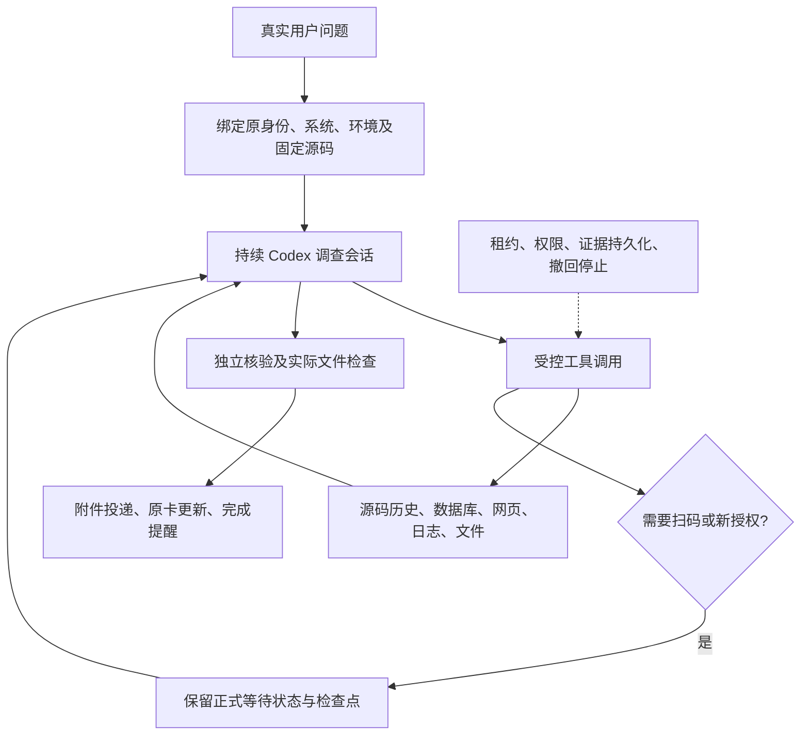

# 持续会话直接调用调查工具

## 用途与流程

旧连续调查已能保留同一个业务任务，但源码执行、环境规划、源码复核仍可能分别启动模型调用。新执行器让源码调查的 Codex 会话直接选择既有授权工具；环境执行器作为协程返回下一份工具目录或取证结果，不再创建另一个环境模型。

这减少的是阶段交接和重复规划，不承诺删除必要的模型推理、数据库依赖或核验。每次主模型处理工具返回仍可能需要一次模型推理，不能把“一个持续会话”说成“只请求模型一次”。跨源码环境仍先通过既有独立固定源码交接；不把测试、生产或其它系统的证据混成同一版本。

## 配置与兼容

Runner 配置 `analysisEngine` 对应环境变量 `AGENTOS_ANALYSIS_ENGINE`，可取 `legacy` 或 `native-tools-v1`。默认 `legacy`，新引擎先在隔离验证中启用；独立实例在 runtime/instance.local.json 配置 analysisEngine: "native-tools-v1"，启动器校验并在清除继承环境变量后传给本实例 Runner；默认 legacy。正式启用必须在空闲维护窗口更新实例配置并重启，health.analysisEngineForNewTasks 和 Runner 心跳可核对实际选择。不能仅设置变量就声称已完成真实卡片验收。

`native-tools-v1` 只适用于连续只读调查的 developer 阶段。已有 CLI 会话继续使用原引擎；已持久化新引擎检查点的任务保持新引擎，不能在恢复时静默换成 CLI。回退新代码前必须先完成或明确处理这些新检查点，不可把它们交给不支持动态工具的旧版本。

入口：`codex-executor.js` 选择执行器；`native-investigation.js` 管理本机 stdio App Server 与原问题检查点；`investigation-direct-tools.js` 通过原控制平面申请范围，复用 `executeEnvironmentJob`；`investigation-tool-channel.js` 用外层会话的工具选择替代环境模型。写代码、QA、普通聊天流程保持原执行器。

## 权限与恢复

- 只接管 `item/tool/call`，严格绑定当前 thread/turn 和已登记工具。内置命令、文件和权限审批请求仍拒绝，普通聊天连接默认没有工具处理器。
- 数据库、网页、日志仍逐步执行原范围核验、过期续期、跨系统目录检查与完整数据/报表核验。不创建新的数据库权限，不把群成员提升为管理员。
- 环境工具保留原连接、结果存储、草稿与独立文件检查；真实等待、失败及未知结果不会变成已成功取证。
- 每个动态调用以任务/提问者/工作区/thread/callId 和参数摘要绑定，结果持久化后才回给模型。重复相同调用复用回执，改变参数拒绝；执行后未能持久化的未知结果不盲目重放。
- 回执位于任务 exports/tool-results，处于模型可写 working 之外。大结果保留完整引用及分页读取，避免重复向上下文灌入全量数据。
- 关闭、进程退出和用户撤回仍走现有任务进程树。任务进行中不切换引擎、不重启消费者。

## 验证与观测

定向测试覆盖旧线程兼容、并发重复调用、跨线程拒绝、未知调用恢复、两来源协程、撤权、登录等待与源码环境切换。真实模型隔离试验使用合成数据，记录 `nativeTiming.modelSessions`、`environmentModelSessions`、工具调用数和墙钟时间；这些不是完整业务卡片的速度验收。

生产切换前还需同题真人新卡对照：保持模型、数据范围和验收要求一致，分别记录排队、源码准备、模型与工具、核验和投递耗时；无论成败均撤回维护测试消息。不得以减少交接次数推算整题提速比例。未验证其它操作系统及完整跨机迁移；打包需包含新模块，私有迁移保留原任务检查点、源码、数据集与工具回执。

### Legacy-shaped continuation compatibility

If the native model still returns environmentQuery, websiteQuery or sourceHistoryQuery, the host consumes the request through the same validated direct tools and supplies the observation to another turn on the same App Server thread. It does not hand that request back to the nested environment-model pipeline. Host-generated continuation operations use durable call receipts as well. Genuine login/approval waiting and independent source-environment transitions still leave the turn with their original state. nativeTiming distinguishes modelTurns and hostContinuations from modelSessions.

An unknown tool name is not a database permission refusal. The investigator executes nothing and returns its actual catalog for correction. An identical unexecuted choice repeated after this feedback is reported as TOOL_SELECTION_REPEAT, preserving evidence. This is semantic no-progress detection, not a task duration or total-call cap. Actual grant revocation and scope errors still stop the attempted read.

Native environment opens carry the host-owned, still-open `original-question` goal into the existing continuation validator. A request cannot introduce arbitrary goals or bypass scope, approval or source/environment checks. Opening or closing a source does not mark the question verified. CNB PR GET retries respect server Retry-After (seconds or HTTP date), check the current grant while waiting, and distinguish rate limiting from missing permissions. Exhausted temporary retries preserve partial pages; callers should request only failed repositories instead of repeating successful inventories. These retries do not add a whole-task deadline.
