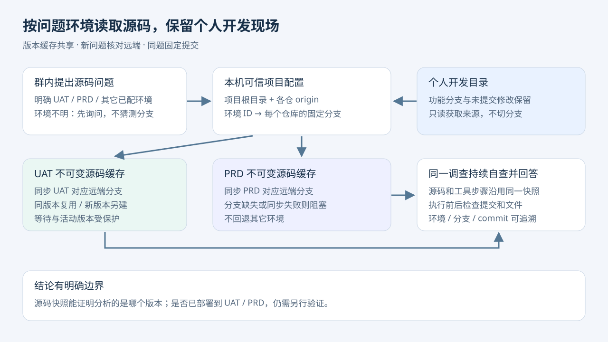

# 分析前同步 origin 分支

## 目的与入口

`analysis` 不再把未确认版本的本地代码当成最新源码。真实 Codex 执行前，Runner 读取 `projects.local.json` 中管理员维护的 `analysisRepositories`，同步成功后才启动原有 read-only/never 沙箱。聊天、卡片翻页不触发同步；普通成员仍不能创建实施任务。

## 按环境建立独立源码快照（推荐）

用途：让群内问题与人工分析选择相同项目、相同环境分支，同时保留个人功能分支及未提交文件。`repoPath` 是来源根目录；`analysisSnapshotRoot` 是独立分析目录，二者不能相互包含。模型只选管理员配置的环境 ID，不能指定任意路径或分支。

```json
{
  "repoPath": "/your/project/root",
  "analysisSourceMode": "isolated",
  "analysisSnapshotRoot": "/your/agentos/data/analysis-sources",
  "analysisEnvironments": {
    "uat": {
      "description": "系统测试 UAT",
      "repositories": [{"path": ".", "branch": "docs-main"}, {"path": "service", "branch": "uat-merge"}]
    },
    "prd": {
      "description": "生产 PRD",
      "repositories": [{"path": ".", "branch": "docs-main"}, {"path": "service", "branch": "wl-prd"}]
    }
  }
}
```

这是示例映射，必须按自己团队的发布文档填写；不要认为所有项目的 UAT 都叫 `uat-merge` 或 `wl-uat`。可选 `defaultSourceEnvironment`，省略时，用户未说明环境就先询问、不启动任务。分支不存在、认证失败或路径无效均阻塞，不回退其它环境。明确跨环境比较应分别提出两次分析。

1. 在 `config/projects.local.json` 的项目项配置来源根目录、环境与各仓分支。Windows 使用本机绝对路径（JSON 中反斜杠要转义）；根目录不是 Git 仓库时省略 `.`。配置后在空闲时备份并重启。
2. 群成员发起只读源码问题；聊天决策写 `sourceEnvironment`，程序验证 ID 并持久化到 Job。环境不明确时返回可选项。数据库/Nacos 的访问审批与这里的源码环境选择分别处理。
3. Runner 从来源仓只读获取 origin，核对远端指定分支实际提交。同版本复用已核验快照；新版本在临时目录独立复制本机Git对象，再从origin浅拉取指定分支、核对提交并 `checkout --detach` 后原子发布。个人项目不执行 fetch、checkout、stash 或 reset；未提交内容与未推送提交不复制进快照。不同环境及提交隔离，正在使用的旧版本不覆盖。
4. 根仓及独立子仓保持相对布局；Codex 在快照目录中以 read-only/never 调查。原个人目录和其它环境不作为本次证据。这是工作目录与证据规则，不新增文件读取权限沙箱。
5. `result.sourceSync` 记录 environment、sourceRoot、workspace、checkedAt、每仓 path/branch/commit；本机 `source-manifest.json` 校验清单。调查前后复核工作树与提交，负责人汇总复用同一快照、不重新拉取。回答应注明环境及相关仓库分支/提交；历史证据不代表现在的源码或实际部署。
6. 健康检查新增 `analysisSnapshotPolicy=isolated-environment-source-v1`。旧 `analysisSourcePolicy` 保留表示兼容模式仍受支持。新发任务验证实际 workspace、分支与提交，不重跑旧任务，也不替换旧卡片。

快照需要磁盘空间，按最近环境版本与活动依赖自动清理，详见下节。带构建所有权标记的失败残留可回收，未知残留由维护者检查；不能直接删除等待任务需要的整个快照根目录。浅克隆不含完整 Git 历史，不得把缺历史当成提交不存在。源文件同步不证明 UAT/PRD 服务已部署该版本。



## 兼容模式配置（在原目录快进同步）

```json
{
  "repoPath": "/your/project/root",
  "analysisRepositories": [
    { "path": ".", "branch": "spec-main" },
    { "path": "service-a", "branch": "business-main" },
    { "path": "web-a", "branch": "release" }
  ]
}
```

每个 path 是 repoPath 内独立 Git 仓库根目录的相对路径；根目录非 Git 时省略 `.`。branch 必须是该仓真正要查的分支，且已经在本地检出；不从用户消息、模型结果、根仓 baseBranch 或 repo.json 猜测。不允许绝对路径、越界符号链接或重复仓库。单仓配置为 `[{"path":".","branch":"main"}]`。

清单限定同步范围，分析提示词要求只使用清单内仓库。它不是新增的文件访问沙箱：Codex 仍具有原 repoPath 的只读访问范围。非 Git、被忽略或未跟踪文件不属于 origin 版本证据。需要其它仓库时由管理员补充清单；清单缺失时阻塞，不静默退回旧代码分析。配置和代码更新后在无在途任务时停稳重启；health.analysisSourcePolicy 应为 origin-ff-before-analysis-v1。旧任务不自动重跑。

## 兼容模式执行链与保护

1. 在任务进程内先校验 Harness，再预检所有仓库：指定分支、干净工作树、无未结束合并/变基/挑选提交/二分检查。
2. 对每个仓库执行 `git fetch --no-tags --no-recurse-submodules origin refs/heads/<branch>`，获取本次远端提交。全部仓库确认可快进后，执行 `git merge --ff-only --no-edit <commit>`。这是拆开的安全 pull，可分别记录远端快照并预检，不进行自动合并提交。禁用 Git hooks 与递归子模块更新。
3. 分支错误、detached HEAD、未提交文件、未推送提交、分叉、缺远端分支、网络/认证失败或单命令超过 120 秒均阻塞；不 stash/reset/强推/自动切分支，不输出 Git 原始错误或含凭据 remote。Git 使用已有本机认证，不弹出交互索取密码。
4. 成功保存 `result.sourceSync`：policy、checkedAt，以及每仓 path、branch、before、commit、changed。提示词收到同一证据；Codex 仍只读、不执行 verifyCommands。
5. 分析完成后再次核对每仓提交和工作树；变化则结果 blocked，不能返回有效源码结论。负责人汇总沿用开发证据，在前后核对，不再次 fetch/pull。没有本次证据的旧链需要新发分析。

同步失败返回 outcome=blocked，既不运行调查 AI，也不自动流转负责人。若是分析后的版本复核失败，调查已执行，但其结论不会作为有效结果发布。同步不写业务实现，但会更新 Git 元数据与工作树到远端版本；这项准备动作由管理员配置授权，不授予普通成员或模型通用写入权限。

## 兼容模式限制与排查

- 多仓同步不是原子事务：后段失败可能已有仓库更新；不自动回滚。查看本机 git status 和提交后处理，再新发分析。
- 它保证所记录时间的 origin 提交，不保证远端之后没有新提交，也不证明部署环境就是该版本。
- Runner 池可并发执行不同 Job；isolated 模式按环境和提交共用不可变快照。兼容的共享目录模式仍可能受外部编辑器/Git影响，前后检查只能发现持续变化，不能完全检测“修改后又还原”。任务期间避免其它进程修改同一共享目录。
- 子模块、其它任务的 worktree 和依赖不自动初始化/更新；需要的独立 Git 仓库须明确配置。
- Windows 保留现有进程树取消机制；此新增同步在 macOS 用本地 Git 夹具验证，Windows 尚需平台实测。
- 群内“以后记住”仅进入历史对话，不会自动改持久规范；本规则由代码、配置与固定角色文件落实。

## 验证

`node --test test/source-sync.test.js` 使用临时 bare origin 与独立检出，覆盖远端新提交、分支隔离、全仓预检、脏树、detached、ahead/分叉、越界/缺配置/缺远端分支、敏感错误隐藏、汇总不拉取与分析前门禁。另覆盖本地未推送提交及暂存删除保留、来源对象删除后快照仍独立可读、拒绝外部对象依赖和浅来源兼容。完整回归运行 `npm run check`。真实群验收应新发一次分析，核对结果的 sourceSync 和只读行为；不得以单元测试替代真实飞书验收。

## 同步阻塞时提醒管理员

群内 analysis 因 Runner 的源码同步或版本复核门禁受阻，结果标记 `sourceSyncBlocked: true`。在已启用动态卡片的部署中，终态卡片后由最初接单的机器人回复原消息，同时 @ 原发起人和 `ownerOpenIdsByProfile[originProfile]` 的管理员；没有该 profile 配置时沿用 ownerOpenIds，显式空列表不回退。仅使用当前应用内的合法 open_id 并去重，不从 humanIdentities 推导管理员。

提醒进入原有持久化 outbox，首次入队即固定收件人；失败重试同一内容与幂等键，不重新执行任务。普通业务 blocked、聊天、私聊和成功结果不新增管理员提醒；旧任务没有该结构化标记，不追补历史通知。管理员须在原群且可被对应应用识别，配置缺失不会猜测身份。

Runner 是本机执行进程，不是飞书机器人。管理员被提醒不是自动批准处理冲突；不放宽分析沙箱，不自动 stash/reset/解决冲突，不授予普通成员实施权限。后续修改需管理员明确提出实施请求；当前只读任务不变为可写。真实群 @ 效果须另行验收。

## 不可变快照缓存与清理

1.48.0 起，isolated 模式的新问题先读取每个配置仓库的远端指定分支 tip，以项目来源、环境、仓库路径/来源/分支及实际提交生成缓存键。远端无法核对时阻塞，不用旧缓存或其它环境冒充最新。同版本的不同问题共用一份已核验的源码；新版本在临时目录完整生成、核验后原子发布。同步中分支变动时继续获取首次核对的固定提交；取得失败明确受阻，不切换到新提交，不覆盖正在使用的快照。原项目分支和未提交修改不变。

1.48.1 起，首次构建在已配置来源仓含目标提交时直接使用它，否则优先选择同仓、同分支、同origin且HEAD与清单一致的既有缓存作为对象种子，无可用精确缓存时完整来源仓优先于旧浅缓存，其余情况使用最近可用缓存或来源仓；独立复制Git对象与浅仓边界，并为detached种子建立仅用于传输协商的临时ref，再从实际origin拉取明确的环境分支，核对提交与先前远端检查一致。复制阶段不检出个人工作区、不使用硬链接，借用的外部对象通过dissociate解除依赖；支持完整仓及浅仓。发布前只保留指定远端提交的detached HEAD，删除种子仓复制来的其它refs/reflogs并重打包、移除不可达对象，个人未推送分支、暂存和未提交文件不成为快照内容。对象清理只作用于尚未发布的构建临时仓，绝不在来源仓执行。构建和复用均拒绝残留Git alternates/http-alternates，防止后续个人仓清理影响快照。种子仅减少传输，远端核对失败仍阻塞；迁移前旧路径的缓存只提供对象，不能直接作为新机证据。无需新增项目字段；单次fetch网络请求窗口从120秒放宽到600秒，其它Git命令保持120秒，不增加整任务、轮次或调用数限制。

同一问题继续使用其原提交；`checkedAt` 为快照首次生成时间，新问题的 `remoteCheckedAt` 为本次远端核对时间。Git commit 不能证明线上部署版本。

自动清理在启动、每日维护、任务完成/失败/取消后触发。每个项目/环境保留最近选用版本（包括远端回滚后重新选用的旧提交），并额外保留活动/等待问题及待交付文件需要的版本。有排队或执行中的项目先跳过，下次重试。源码准备与清理使用同一 POSIX 文件锁，先加锁再读最新任务状态，不根据快照年龄删除正在使用的文件。进程结束由内核释放锁，无锁文件过期猜测。历史问答仍按 retentionDays 处理；已结束问题的源码目录可能先回收，报告、仓库路径、分支、提交及核验记录保留。需要调查当前版本时应发起新问题，不承诺被回收的旧工作目录仍能打开。

只处理隔离缓存根目录内带有效所有权清单的 `analysis-*` 容器；未知或未完成的 `building-*` 临时目录保守保留。根目录或祖先符号链接、路径重叠、异常清单、Git worktree、HEAD不符、未提交修改及未知符号链接保守保留。仓库已跟踪的源码符号链接仅删除链接本身，不跟随其目标。系统业务仓、配置、账号凭据、历史报表均不属于此清理。保留的活动版本可能超过每环境一份；异常副本需人工检查，不能保证固定空间上限。

macOS/POSIX 运行环境需可调用 Python3 和 fcntl；锁不可用时明确失败，不跳过保护。Windows isolated缓存的此锁方式尚不支持，不能直接照搬部署。

维护先预演（只读状态，不执行删除）：

```sh
node scripts/prune-source-snapshots.mjs --projects /your/agentos/config/projects.local.json --state /your/runtime/data/agentos.json
# 核对 removed / kept / unknown 后，经当前本机实例鉴权及权威状态写锁应用：
node scripts/prune-source-snapshots.mjs --apply --server http://127.0.0.1:YOUR_PORT
```

默认预演不删除缓存；锁文件可能创建。apply 不改变任务状态、服务注册或凭据。运行态应由服务内维护器清理，避免手工读取正在改写的状态文件。删除数量和跳过原因由返回记录核对；保留清理记录供迁移验收。

1.49.0补齐按需祖先历史、固定提交恢复、Git元数据边界及待投递引用复核；保留完整种子中固定提交可达祖先。具体工具、兼容、锁与迁移边界见[多系统通用能力](multi-system-capability-audit.md)。


## 1.52.1：源码同步诊断与临时失败恢复

用途：新问题准备源码时，将失败仓库、分支、阶段和脱敏原因显示在原卡片，避免把所有错误都称为“远端可能变化”。无需新增配置或凭据；更新 Control Plane 与 Runner 后按本实例空闲维护流程重启。入口仍为新只读调查，旧任务仅在维护者明确授权后恢复，版本不自动替换。

- git层只对ls-remote、fetch的连接故障、TLS/HTTP 429/5xx和单次请求超时重试，每次请求最多3次，间隔1秒、2秒。原卡显示重试进度；达到请求重试上限时记录具体受阻环节。这不是整个问题的时间、轮次或调用总数上限。认证/分支缺失、证书信任异常、磁盘、权限、对象损坏、检出过滤器和未知错误不盲目重放；不重放模型会话、业务查询或写入。
- 构建逐仓显示进度，失败记录sourceFailure：repository、branch、stage、operation、code、attempts、retryable、exitCode。原始stderr、命令参数、URL、凭据不进入卡片或持久诊断；未知错误准确标为尚未归类，不能据此断言网络故障。现有旧失败不可能凭新版补回已丢失的原始原因。
- 先核对远端分支tip。如果随后分支前进或回滚，临时独立缓存继续fetch首次核对的SHA并验证FETCH_HEAD，成功后只检出该提交；不能取得该固定对象则保留真实错误，或标明固定提交不符，绝不默默选新tip。HEAD和个人工作区不受补取影响；历史续查仍恢复原清单。
- 保留所有已配置仓库的完整性门与跨进程锁，不能自动假定某仓无关而跳过，也不能把残缺快照发布为完整。修复解决错误分类和可恢复远端读取；不会保证远端/网络永不失败。需要调整调查依赖范围，应由管理员修改可信项目配置并独立验证，模型和群消息不能绕过。
- 验证覆盖真实本地远端分支前进/回滚、凭据脱敏、临时错误恢复和耗尽、不重放非远端读取、两环境并发/旧快照复用及路径/共享对象保护。真实CNB可读性与群任务成功单独记录在部署实例中；测试注入故障不等于真实断网。

失败排查：先看原卡阶段与code；认证按本机安全凭据流程恢复；磁盘/权限/对象异常由维护者检查具体缓存与来源，不删除业务工作区。恢复后按原问题和原提交接续，不新建问题掩盖失败。迁移代码包须含source-git-diagnostic.js，完整迁移仍保留当前状态、清单、datasets与tool-results。POSIX锁仍依赖Python3，Windows和完整跨机未因此获得实测保证。
