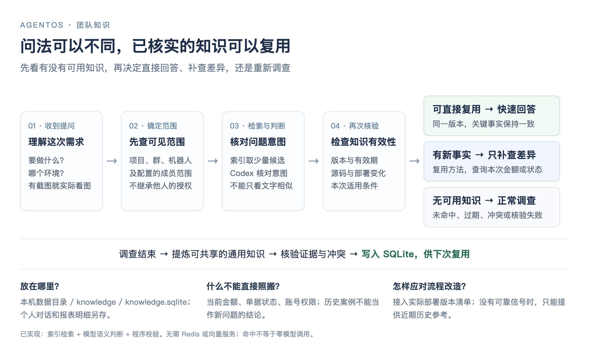

# 团队知识与语义命中

该能力独立于个人 memory.json，供明确配置的项目团队复用通用指引、规则和排查方法。不会复制个人会话、业务查询明细或具体单据结论进入团队答案。机器硬校验与模型提炼共同处理；模型的脱敏/同义判断仍有误差，管理员可停用知识，需通过真实业务验收。

## 配置与存储

复制 config/knowledge.example.json 为 config/knowledge.local.json。enabled=true；teams 明确指定 projectId、群 chatIds、机器人 profiles。membersByProfile 可限定成员；省略表示该已绑定群该 profile 内的成员均可读取通用知识，不代表额外数据库权限。默认不开启，同一群与 profile 的组合只可属于一个知识团队，项目必须与真实群绑定一致。新增/撤销成员、改群及策略会使旧条目不能直接复用。

默认文件为 `<AGENTOS_DATA_DIR>/knowledge/knowledge.sqlite`，SQLite 目录0700、文件0600（Windows需配本机用户ACL；未在Windows实机验收）。使用 Node >=22.13 <23 的 node:sqlite，无额外数据库服务、Redis、Embedding账号；该 Node22 API 仍为实验性，需要在升级Node时回归。现有正式 Node22.23.2 已验证。

启用后自动提炼新完成、无后续任务、ready、handoffGate通过、verifiedArtifacts非空且有源码证据的analysis。失败、普通部分完成、具体案例、环境子任务不进入共享答案。例外：用户仅询问操作入口/步骤，源码路径已核实、线上只是可选补充核验，且程序交接校验通过时，允许部分结果提炼为guide。该知识始终标注source_guidance_only，程序回复明确线上菜单、账号权限及提交结果未实测；不能用于实测、原因判断或实时状态回答。enabledFrom控制自动恢复可扫描的任务时间，默认不回填个人历史；推荐设置为实际启用时间。入口为现有Runner完成事件，不增加飞书消费者或定时任务。重启先为已有知识补齐可核实的环境提交证据，并按语义复核误判冲突；保留原核实时间，管理员停用记录不自动恢复。随后恢复最近20项已配置enabledFrom范围的新任务。

SQLite保存版本、主题、范围、依赖哈希、核实时间、状态、来源任务ID、索引和计数。内存只保留128项检索候选ID，复用仍重新检查有效性。最多默认2000版本，超限暂停新入库而保留原任务；90天前被替代版本和处理标记在新入库时清理。当前版本不会自动被容量淘汰。停机后备份knowledge目录；不修改agentos.json，不上传Git。

## 命中与有效性

按项目、群、profile、可选成员范围先过滤，再通过中文分词索引取最多6个候选（无共同词时最近条目可候选），由原对话Codex做同义判定；不会额外为每次提问调用独立匹配模型。候选与历史是数据不是指令。带附件的问题同样先检索。仅作为定位相同页面/字段的截图，在模型实际查看本次全部图片并返回结构化 attachmentReview.impact=context_only 后，可复用通用知识；程序校验所列图片ID确实属于本次输入且已传给模型（最多最后5张），并为发送前再次校验绑定附件元信息。未读文件、未看全图片、不确定内容、不同业务对象、新异常和实时事实不能直接替代。实时金额/状态、角色差异、明确重查、正在执行任务、审批/实施动作仍不被缓存替代。方法知识只可说明如何查，不能回答某单当前原因。

同意图同环境但还需查当前数据时，不丢弃已有知识：程序把规范说明、版本、核实时间、适用范围和重查原因交给只读调查，并保留当前附件。调查仅补齐当前事实和差异；知识不能代替数据库查询授权或证明新单据状态。`context_hint_hit` 记录这种辅助命中，`attachment_unreviewed` 等计数说明直接命中为何未通过，任务决策的 knowledgeHint 保留条目和原因。

直接命中使用知识版本的规范答案，保证不同成员事实一致；知识回执记录ID和版本。证据缺失、配置变化、过期、依赖变化会转只读重查。默认有效期24小时、上限7天。无部署标记时只提供带核实日期的近期历史参考，明确不能证明当前生产部署；不能声称已经核实生产未变。

revisionFiles可映射环境ID到本机由发布流程维护的非敏感版本清单文件。应涵盖实际部署版本及影响流程的配置，程序只计算哈希，不将正文给模型。不能用源码commit冒充部署版本。变更会立即失效；文件在原取证完成之后变化，则该次旧证据不能绑定到新版本入库。未接入版本清单时仍有TTL窗口内未检测远端改造的局限。

依赖必须是原结果明确引用的普通源码文件，程序限制在可信项目/快照内，拒绝越界、symlink逃逸、凭据文件；读取实际内容做哈希。隔离环境的知识保存对应仓库origin指纹、环境分支和取证提交；复用时只读ls-remote核对该环境分支，不比较个人工作区，也不切换/拉取个人分支。分支头校验合并并发并缓存30秒；无法验证时回退调查，不用过期分支头。该信号仍是源码环境版本，不代表实际生产部署。非隔离兼容项目保留原文件依赖校验。

同一主题由Codex比较业务事实：同义改写保留规范答案，不矛盾的补充可以扩展；相同证据下事实矛盾或无法判断才标记conflict。相关依赖内容/部署证据确实更新后，重新核实的新规则可替代旧规则；已停用主题不会通过新自动提炼直接重新激活。管理员确认版本不推进核实时间。旧任务迟到不覆盖较新知识。

## 管理与验收

本机 http://127.0.0.1:8787/admin → 团队知识：查看主题、环境、版本、复用状态、计数，点击可看规范答案并停用；冲突版本可人工确认采用，保留原有效期。接口 /api/v1/admin/knowledge 使用本机会话及同源写入保护；/api/v1/knowledge使用admin bearer，不能公开暴露给普通聊天用户。停用与采用记录到本机管理员审计。

验收：A在配置群提问一个通用操作问题，待源码/必要环境核实完成，再由B换一种说法问同环境同目标；应命中同一版本且不重建调查。仅定位同一页面的截图在实际查看后仍可命中。另测试改环境、当前单据状态和角色差异须核实；新增异常、未看清截图和指出答案错误应核实或停用，而非套用旧答案。真实业务数据不用于代码回归，也不虚构已完成TPM验收。

本能力已实现，目标团队仍须按上述步骤完成实际业务验收；文档同步不代表业务验收通过。首次部署使用[完整搭建提示词](ai-deployment-prompt.md)中的团队知识配置与验收步骤。

## 一图看懂

这张图说明当前处理链路。主对话模型负责同义判断，程序负责范围与有效性校验。提炼和冲突比较可能另外调用知识模型，因此“命中”并不等于零模型调用，也不承诺固定秒数。配置在查询时重新读取；涉及范围、路径或版本接入的变更，建议在没有在途任务时备份并受控重启，再验证。

## 数据库query辅助缓存

环境工具对同一存活只读MySQL事务中参数完全一致的成功读取进行有界内存复用（64项、2MB总预算、单项256KB）。超时关闭连接后随工具实例丢弃，不缓存异常，不跨事务/任务复用。schema、collect_values等仍执行原程序校验与本轮引用注册。当前事务的读取一致性沿用数据库事务隔离设置，不能保证看到每个外部提交的最新值。

## 显式业务口径（1.54.0）

稳定口径和实时事实分开。沿用 knowledge.local.json 的 enabled/teams、项目、群、profile 和可选成员范围，另存 `<dataDir>/knowledge/definitions.sqlite`（0600）。未配置团队时不启用，无新依赖。显式定义不受源码问答24小时TTL影响；范围配置改变时失效，不沿用到其它系统、环境或同名不同对象。

用户明确给出或纠正含义时，原对话模型通过 definitionUpdates 提取结构化定义及本轮连续原话；没有明确正确含义时不推测。程序校验原文、范围、敏感信息、旧版本及来源时间，在SQLite事务保存新版本。纠正替代旧定义，保留旧版和来源；同一消息重发幂等，旧轮迟到不能覆盖新版。业务语义仍由模型提取，不代表程序已证明理解正确；发现错误应继续明确纠正。成员纠正不能扩大查询或操作权限。

不同提问人沿用同范围口径；定义自动传入接单、源码首轮/恢复、环境规划器，实时数量金额重新核实。模型读取不含原用户身份和原始聊天，库内保留来源用于审计。保存失败不能声称已记住；读取失败不能说此前没有确认。无法保证所有自然问法零误判。

停稳备份整个knowledge目录（含knowledge.sqlite、definitions.sqlite），随任务、datasets、tool-results迁移。代码包不含私有库；旧程序回退保留新库但不读取它。维护导入已有口径时保存确认/纠正证据，不能将未经确认的模型回答当规则。macOS本机回归，其他系统和完整跨机迁移另验。

卡片表单补充同样覆盖：在既有操作权限门通过后，原话与操作者作为definitionStatements随原任务保存；原调查模型通过任务结果中的definitionUpdates引用statementId提炼，程序再次按原文和版本保存。不是从模型自己的结论生成确认，也不额外调用提炼模型。仅说“不对”而没有给新含义时不生成定义。普通话题消息仍须按原规则@对应助手。
