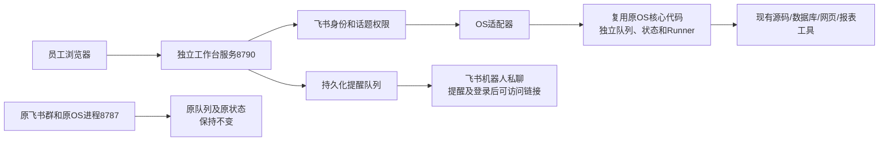

# AgentOS 私有工作台

浅色聊天网站，复用现有 AgentOS 核心执行代码。它不是把 `/admin` 开放给员工，也不把私有问答转发进飞书群。

## 立即体验

在仓库根目录使用项目要求的 Node22：

```sh
npm ci
npm run start:workbench
```

打开 http://127.0.0.1:8790 。默认是明确标注的**本机体验模式**，只有合成回复和体验文件，不查询 PRD、不调用真实模型、不发飞书通知。页面可切换三种体验身份；负责人有“全部对话”，其他成员只有自己的话题和受邀话题。体验入口只能绑定本机回环地址，不能作为企业登录上线。

## 实现与原 OS 的关系



Web入口有自己的进程、状态文件、源码缓存和临时控制端口。内部控制端口仅绑定127.0.0.1并使用进程随机令牌；对用户只开放工作台端口。没有接收原群事件的长连接，没有往原群发送消息的出口。既有卡片机制被本地适配器接收为执行状态；前端显示实际结果与进度。核心任务仍按原角色、管理员、只读和核验规则执行，不能把负责人“可看全部话题”当作生产写权限。

正式模式读取既有项目/机器人配置，并把环境配置首次复制到自己的私有目录；后续接入修改自己的副本。网站使用独立浏览器模式，不能通过它控制日常 Chrome。已有凭据引用仍由原受控工具使用，不复制或显示密码；账号密码不能通过Web聊天提交，网页登录在独立本机浏览器完成。原 OS 的业务工具缺口、Codex连接问题和授权生命周期不会因为新界面而自动消失。

## 正式接入

1. 将 `config.example.json` 复制为 ignored 的 `config/workbench.local.json`，填写实际值。
2. `coreConfigDir` 指向原实例配置目录；`dataDir` 必须独立于原实例 data。`allowedProjectIds` 是本工作台明确开放给该企业登录成员的项目列表，不自动导入所有业务项目。
3. 把负责人在**同一飞书应用下**的 open_id 写入 `ownerIds`。没有权限编辑页面。页面始终披露“你、受邀成员及系统负责人可见”。多人负责可以配置多个已授权ID。
4. 使用原负责人机器人的同一应用进行网页登录。`coreAppId` 和 `feishu.appId` 必须一致；跨应用 open_id 不能混用。飞书后台开通网页应用，设置准确的重定向URL `https://你的域名/auth/callback`。身份使用OAuth授权码换取访问令牌，再由服务端获取用户信息，核对 `tenant_key`。令牌不写入页面或工作台持久状态。
5. 将该应用 App Secret 和随机会话密钥设为进程环境变量，不提交到Git：

```sh
export AGENTOS_WORKBENCH_APP_SECRET='你的应用密钥'
export AGENTOS_WORKBENCH_SESSION_SECRET='至少32字符的随机字符串'
export AGENTOS_WORKBENCH_CONFIG='./config/workbench.local.json'
npm run start:workbench
```

Windows PowerShell 使用 `$env:AGENTOS_WORKBENCH_CONFIG='.\config\workbench.local.json'`，另外两个变量同理；运行 `npm run start:workbench`。Windows流程已提供，当前验收平台是macOS，Windows真实运行尚未验证。

6. 由现有内网反向代理提供HTTPS，只转发8790到受控企业访问入口；不要转发原8787、Web内部控制端口或data目录。应用原站点端口默认仍为回环地址。域名、证书和飞书回调依赖部署团队现有设施，本仓库不自动开公网/修改DNS/放宽飞书应用范围。
7. 使用同一机器人 profile 的既有 `lark-cli` bot认证发送私聊提醒。需要已有发送消息能力，收件者处于应用可用范围并可接收机器人私聊。失败保留outbox、退避重试，绝不因此重新执行模型或任务。提醒只含事件类型和话题链接，不发标题、提问、答案或文件。新问题通知所有系统负责人，结果通知负责人、发起人和当前受邀人，邀请通知受邀人。投递前再次检查话题访问权。

登录会话24小时有效；会话失效只要求重新登录，不取消任务。通知为飞书普通机器人私聊，并非群里的真实`@`；用户点击提醒进入本网站查看话题。未加入的话题即使知道URL也无法查看。

## 使用

- 新对话 → 选择项目 → 填写问题。环境写在问题中，例如PRD/UAT，由现有OS规划器核对；页面不会擅自把所有请求指定到PRD。
- 回答、阶段、失败或等待状态每2秒刷新。刷新/关闭浏览器不取消任务；这是状态刷新，不是模型逐字流。
- 回形针可流式上传文件；原始文件保存在该话题私有目录，发送问题时关联到OS的附件分析链路。没有新设5MB限制。下载按话题权限再次核对，仅核验完成的报表开放下载；CSV可用Excel打开。当前网页内置预览支持文本/CSV/JSON和常见图片，XLSX等下载后用对应应用打开。
- @按钮或已有话题输入@ → 搜索**已登录工作台的同事** → 明确确认开放当前话题的完整历史与文件。仅发起人和负责人可邀请。单纯在文字里打人名/@不授权。第一版邀请检索并非全公司通讯录搜索：同事先登录一次就进入候选。
- 受邀同事可以阅读、回复；发起执行、继续和审批仍由OS按当前真人身份校验。系统负责人侧栏有“全部对话”，可搜索提问人/问题/回答及查看文件。查看/下载/邀请操作记录在审计中。
- 正式模式里的继续、取消、审批通过当前话题的自然语言消息走原OS决策与授权，尚未新增网页的一键审批组件。不要把后台端口作为这些动作的替代入口。

## 数据、恢复与维护

`dataDir/workbench.json` 保存话题、参与人、已验证用户、会话摘要、消息入站outbox、通知outbox和访问审计；上传在`files/<topic-id>/`；复用核心的状态、exports和源码缓存在`engine/`。没有共享知识库提取私有问答。配置、凭据、登录与开发worktree不当作垃圾删除。

服务写文件采用单进程队列与原子重命名，并用`.owner.lock`拒绝第二个进程同时写同一dataDir。正常退出释放锁；异常退出后先核实锁中PID、监听端口、原任务和进程组，再手动移除失效锁，禁止盲删。核心自身按原执行登记恢复机制处理旧进程，不能重启后宣称旧任务成功。消息提交有UUID幂等键，入站失败自动重试；通知独立持久化，不重跑调查。不能承诺第三方消息永久绝对exactly-once：超出飞书幂等保存期的极晚重试仍需运维核验。

保留现有30天历史规则：终态闲置话题到期回收，未结束任务、未接收消息和待通知内容保留。仅按登记删除自管上传文件，不扫描整盘、未知目录或删除飞书消息。Web核心另有既有30天任务和源码缓存策略；它们的配置、数据均独立。删除的历史需重新发起话题，不会悄悄用其它版本结果替换。

关闭只关闭独立工作台，**不停止原OS**。若当前Web队列仍有执行中任务，正常停止请求会保留服务并提示等待；不要用强杀跳过。网页前端和网关变更重启这个独立进程即可；不要求重启原8787。

## 验证

```sh
npm run test:workbench
```

覆盖：三身份访问隔离、负责人可见、邀请和撤销、直接链接与下载、CSRF、租户与OAuth state重放、入站幂等/恢复、通知失败重试和撤权、路径/符号链接、单进程状态保护、30天保留、现有核心实际协作与独立卡片投递。合成模型和模拟通知不代表真实PRD/飞书端到端已通过。正式上线还需验证企业真实OAuth、负责人真实提醒、不同员工身份以及原问题的真实工具与文件交付。
